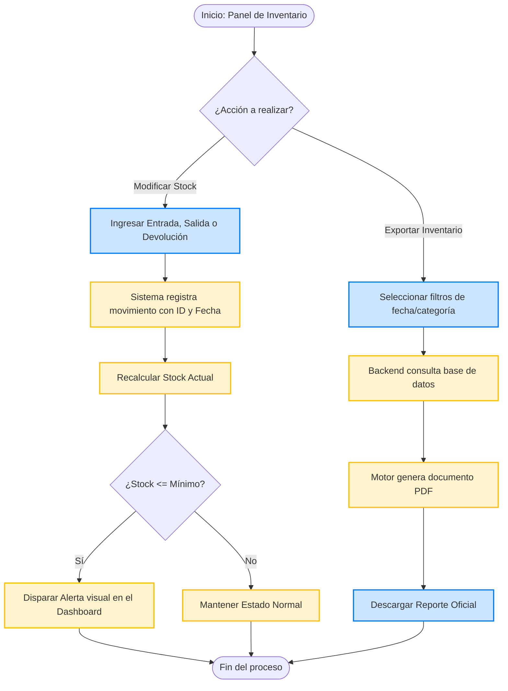

# Proceso 01: Flujo de Gestión de Inventario y Reportes

**Descripción:** Este documento detalla la secuencia lógica de acciones cuando el Administrador interactúa con el módulo de inventario en el Portal Privado, ya sea para registrar movimientos manuales de insumos o para generar reportes formales exportables.

## 1. Reglas del Proceso

- **Cálculo Inmediato:** Todo movimiento (ya sea manual por el Administrador o automático tras la validación de una venta) afecta inmediatamente el stock en la base de datos.
- **Responsabilidad del Sistema:** El sistema (backend) es el único responsable de comparar el nuevo stock contra el umbral mínimo establecido de cada producto.
- **Alertas Visuales:** Cuando se cruza el umbral de escasez, las alertas se disparan visualmente en el Dashboard estadístico del Administrador. No requieren correos electrónicos.
- **Auditoría:** La exportación a PDF genera un documento inmutable con fecha y hora para propósitos de auditoría contable o de bodega.

## 2. Diagrama de Actividad (Mermaid)

