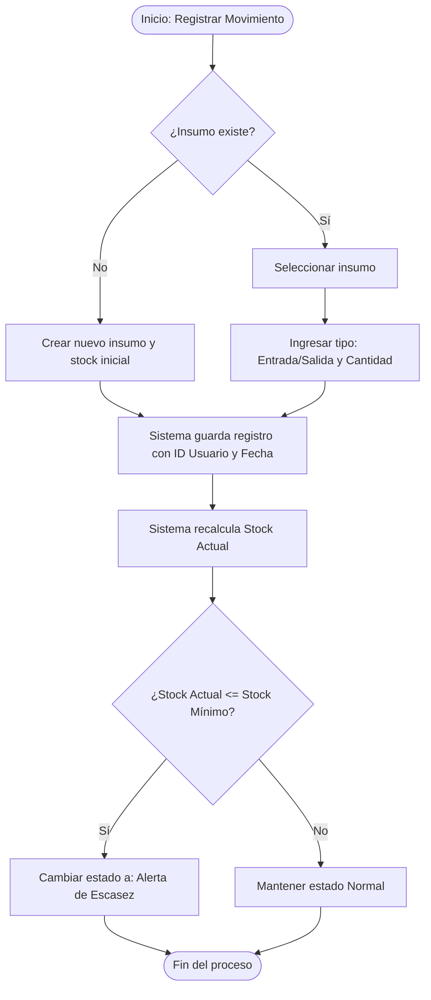

# Proceso 01: Flujo de Gestión de Inventario y Alertas

**Descripción:** Este documento detalla la secuencia lógica de acciones cuando el Encargado de Bodega registra un movimiento y cómo el sistema evalúa los niveles de stock para disparar alertas preventivas.

## 1. Reglas del Proceso

* Todo movimiento afecta inmediatamente el stock calculado.
* El sistema es el responsable de comparar el nuevo stock contra el umbral mínimo establecido.
* Las alertas son visuales dentro del dashboard, no requieren envío de correos en esta fase (MVP).

## 2. Diagrama de Actividad (Mermaid)

