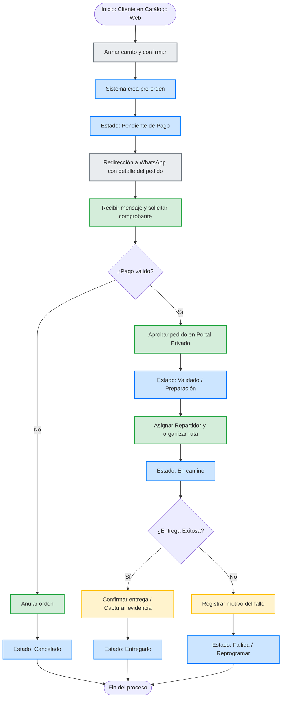

# Proceso 02: Flujo de Gestión de Pedidos, Validaciones y Entregas

**Descripción:** Este documento detalla el ciclo de vida completo de un pedido bajo la arquitectura híbrida: desde que el cliente lo genera en el catálogo web público, pasando por la validación del pago vía WhatsApp por parte del vendedor, hasta el despacho y entrega final.

## 1. Reglas del Proceso

- **Origen del Pedido:** La orden nace cuando el cliente confirma su carrito en el Portal Público. El sistema genera una pre-orden con estado **Pendiente de Pago** y redirige al cliente a WhatsApp.
- **Validación Estricta:** El Vendedor es el único autorizado para cambiar el estado a **Validado** en el Portal Privado, y solo debe hacerlo tras verificar el comprobante de pago en WhatsApp.
- **Impacto en Inventario:** Al pasar a estado **Validado**, el sistema descuenta automáticamente los productos del stock (conectando con el Proceso 01).
- **Evidencia de Entrega:** Para pasar a estado **Entregado**, el repartidor debe confirmar la entrega y, en caso de fallo, es obligatorio registrar el motivo en el sistema.

## 2. Diagrama de Actividad (Mermaid)

