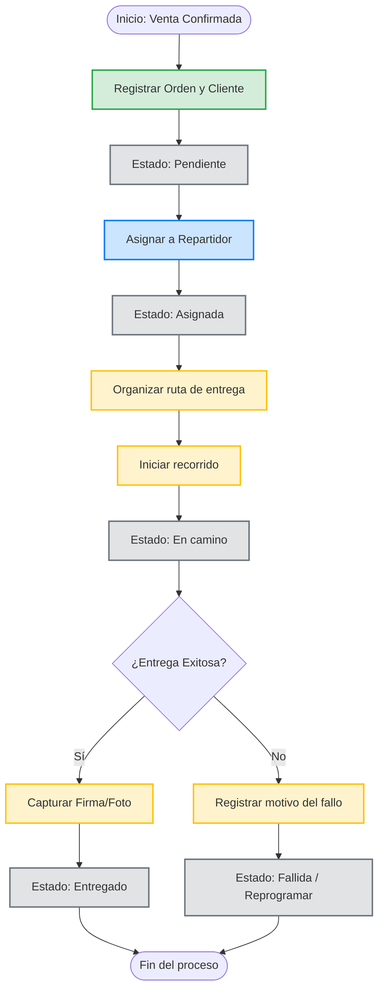

# Proceso 02: Flujo de Gestión de Entregas y Despachos

**Descripción:** Este documento detalla el ciclo de vida de un pedido, desde que se confirma la venta hasta que el producto es entregado al cliente, definiendo las responsabilidades de cada rol en el cambio de estados.

## 1. Reglas del Proceso

* Solo el Vendedor o Administrador pueden crear la orden inicial.
* Una orden recién creada siempre nace en estado **Pendiente**.
* Para pasar a estado **Entregado**, el sistema exige obligatoriamente adjuntar una evidencia (firma o foto).
* Si una entrega falla, es obligatorio registrar un comentario con el motivo.

## 2. Diagrama de Actividad (Mermaid)

