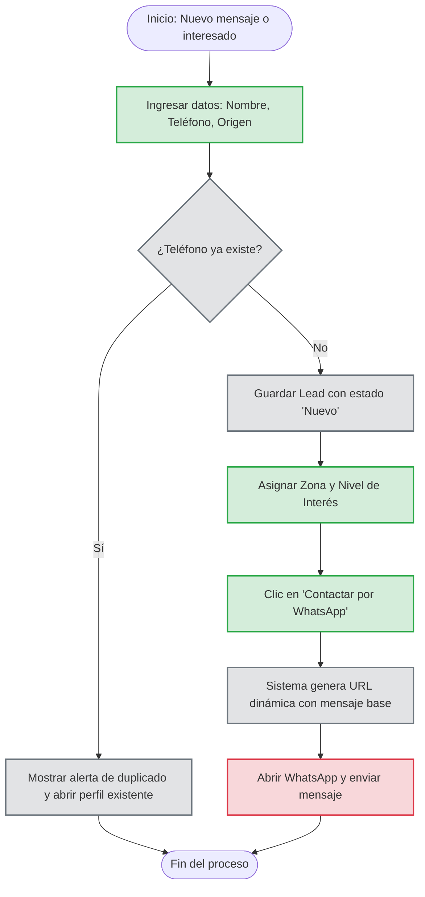

# Proceso 03: Flujo de Gestión de Clientes Potenciales (CRM)

**Descripción:** Este documento modela el embudo de captación de Fresitas. Define los pasos desde que un cliente muestra interés por primera vez, hasta que queda registrado, segmentado y es contactado rápidamente.

## 1. Reglas del Proceso

* El número de teléfono es el identificador único; el sistema no debe permitir leads duplicados con el mismo número.
* Todo lead nuevo ingresa con el estado predeterminado "Nuevo".
* El contacto inicial automatizado no utiliza una API paga, sino la generación dinámica de un enlace de WhatsApp Web/App (`wa.me`).

## 2. Diagrama de Actividad (Mermaid)

