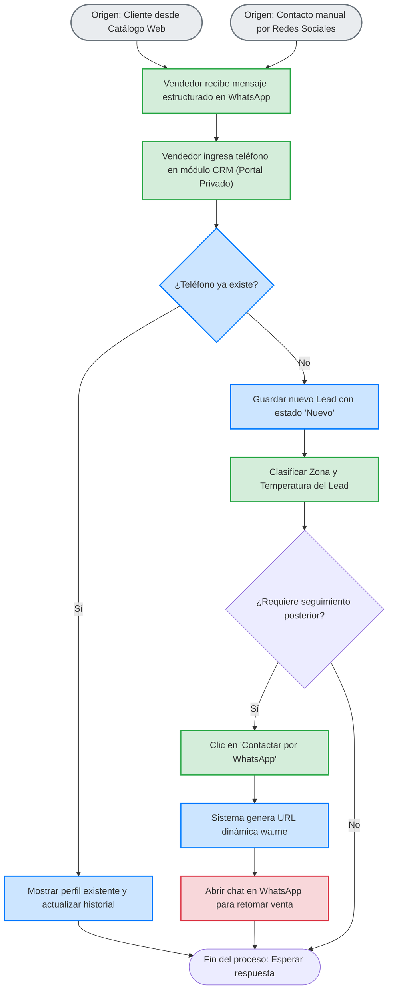

# Proceso 03: Flujo de Gestión de Clientes Potenciales (CRM)

**Descripción:** Este documento modela el embudo de captación comercial de Fresitas. Define los pasos desde que un cliente potencial inicia contacto (principalmente derivado del Catálogo Web hacia WhatsApp) hasta que su información es centralizada y clasificada en el Portal Privado.

## 1. Reglas del Proceso

- **Identificador Único:** El número de teléfono de WhatsApp es la llave primaria (PK lógica) del cliente. El sistema bloquea la creación de leads duplicados con el mismo número.
- **Origen Omnicanal:** Un lead puede originarse automáticamente (cuando el cliente usa el carrito web y salta a WhatsApp) o manualmente (si el vendedor lo capta por Instagram/Facebook y lo registra en el sistema).
- **Clasificación Rápida:** Todo lead nuevo ingresa en estado predeterminado "Nuevo" o "En Negociación" y el vendedor debe actualizar su temperatura (Frío, Tibio, Caliente) según la interacción.
- **Enlace de Retorno:** Para leads registrados manualmente, el sistema genera dinámicamente un enlace de WhatsApp Web/App (`wa.me`) para facilitar el seguimiento con un solo clic sin salir del ERP.

## 2. Diagrama de Actividad (Mermaid)

