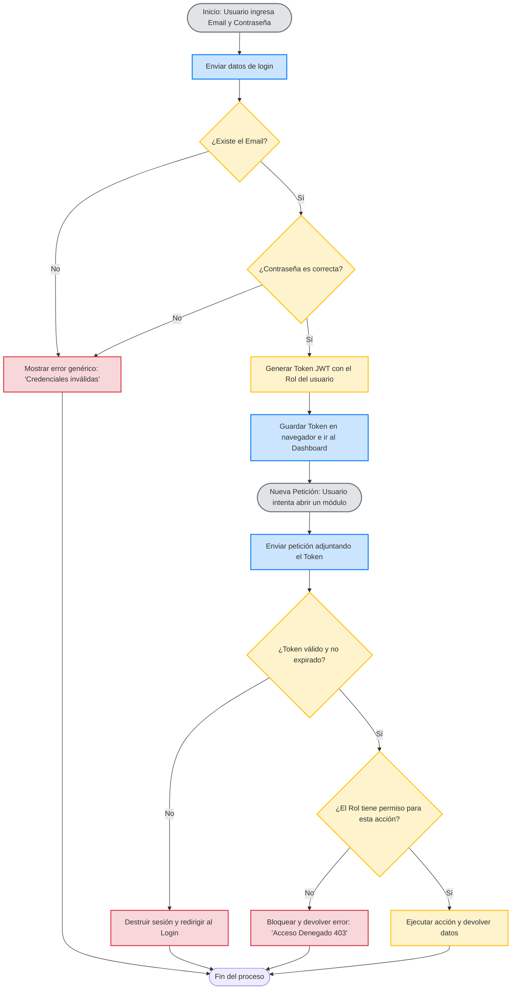

# Proceso 04: Flujo de Autenticación y Seguridad (RBAC)

**Descripción:** Este documento detalla cómo el sistema verifica la identidad de un empleado de Fresitas (Login) y cómo asegura que cada usuario solo acceda a los módulos permitidos según su rol (Control de Acceso Basado en Roles - RBAC).

## 1. Reglas del Proceso

* Ninguna contraseña se almacena ni viaja en texto plano; se utilizan algoritmos de hashing seguro.
* Los mensajes de error en el login deben ser genéricos ("Credenciales incorrectas") para prevenir ataques de enumeración de usuarios.
* La sesión se maneja mediante un Token (JWT) que el cliente debe enviar en cada petición al servidor.
* La validación de permisos se hace de forma estricta en el backend (servidor), no solo ocultando botones en la interfaz visual.

## 2. Diagrama de Actividad (Mermaid)

