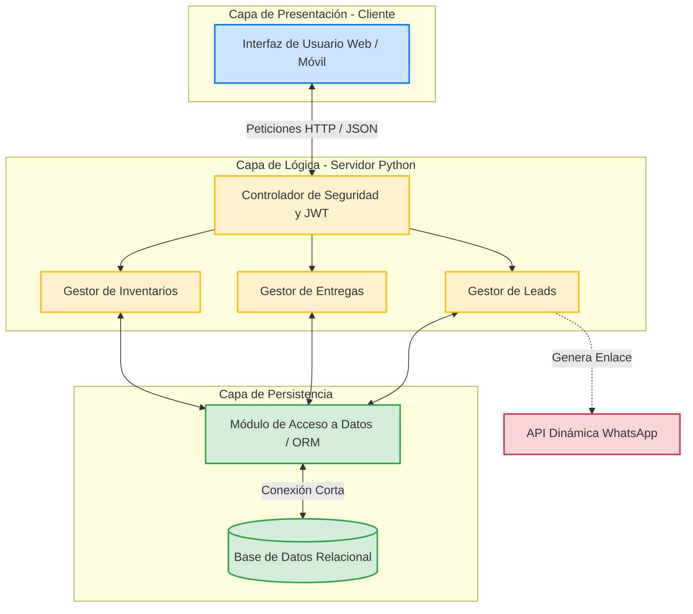

# Visión General de la Arquitectura

**Descripción:** Este documento define el patrón de diseño, la pila tecnológica (Tech Stack) y el modelo de componentes de Etherware, garantizando la escalabilidad y el cumplimiento de los requerimientos no funcionales (multiplataforma, seguridad y rendimiento).

## 1. Patrón de Diseño

El sistema implementa el patrón **Modelo-Vista-Controlador (MVC)** adaptado a una arquitectura de API REST (Cliente-Servidor).

* **Vista (Frontend):** Desacoplada del servidor, encargada de la renderización responsiva y la captura de eventos del usuario.
* **Controlador (Backend/API):** Centraliza la lógica de negocio, la validación de roles (RBAC) y la orquestación de procesos.
* **Modelo (Persistencia):** Capa de abstracción de datos (ORM) que gestiona la comunicación con la base de datos relacional.

## 2. Pila Tecnológica (Tech Stack)

* **Frontend:** HTML5, CSS3, JavaScript Vanilla.
* **Backend:** Python (Framework FastAPI / Flask).
* **ORM:** SQLAlchemy / SQLModel.
* **Base de Datos:** SQLite (Desarrollo local) / PostgreSQL (Producción Cloud).
* **Control de Versiones:** Git / GitHub.

## 3. Diagrama de Componentes (MVC)

