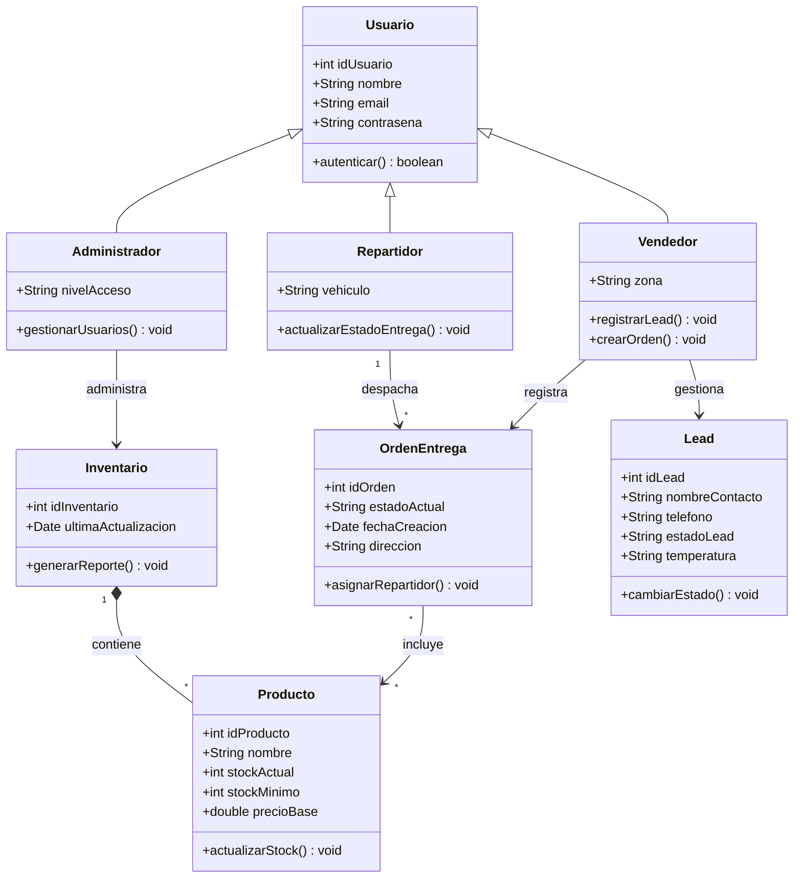

# Diagrama de Clases (UML)

**Descripción:** Este documento define la arquitectura estática orientada a objetos de Etherware. Se aplica el principio de herencia para la gestión de usuarios y composición para los módulos operativos, sirviendo como base directa para el diseño del modelo Entidad-Relación de la base de datos.

## 1. Reglas de Diseño

* **Herencia:** Se utiliza una clase base `Usuario` para centralizar la autenticación, heredando a roles específicos.
* **Separación de Responsabilidades:** Las órdenes de entrega, el inventario y los clientes potenciales (Leads) están aislados en sus propias estructuras.
* **Roles del Sistema:** El cliente final NO interactúa con el sistema, por lo que su representación es puramente un registro de datos (Lead/Cliente).

## 2. Diagrama de Clases (Mermaid)

