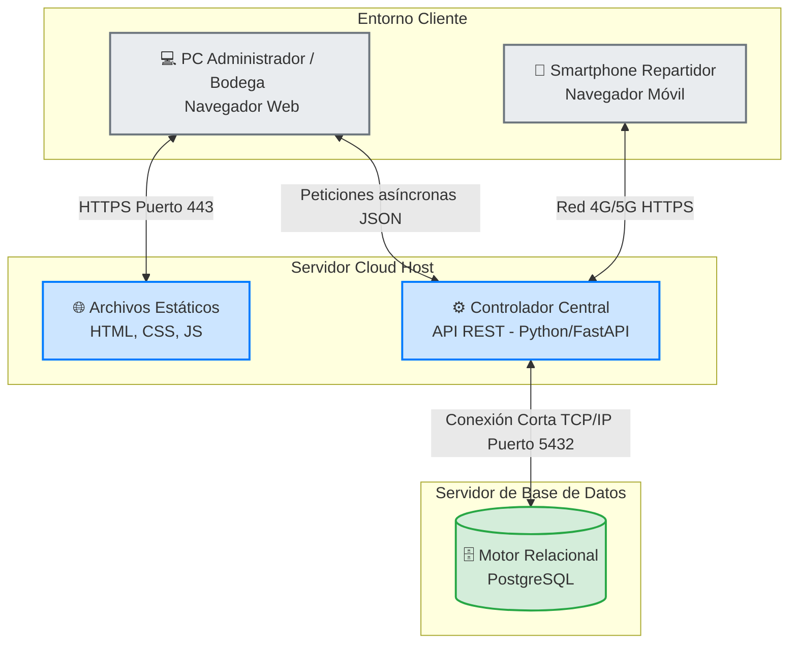

# Diagrama de Despliegue (Infraestructura)

**Descripción:** Este documento detalla la topología física y de red sobre la cual se ejecutará Etherware en un entorno de producción. Define los nodos de hardware, los contenedores de software y los protocolos de comunicación segura entre ellos.

## 1. Nodos de Infraestructura

La arquitectura se divide en tres capas físicas independientes para maximizar la seguridad y el rendimiento:

1. **Capa Cliente (Frontend):** Dispositivos de los usuarios finales (PC de escritorio en la sede de Fresitas y Smartphones de los repartidores en calle).
2. **Capa de Aplicación (Backend):** Servidor en la nube (Cloud VPS) que aloja la API REST construida en Python.
3. **Capa de Persistencia (Base de Datos):** Servidor dedicado y aislado del acceso público, encargado del almacenamiento relacional.

## 2. Diagrama de Despliegue (Mermaid)

