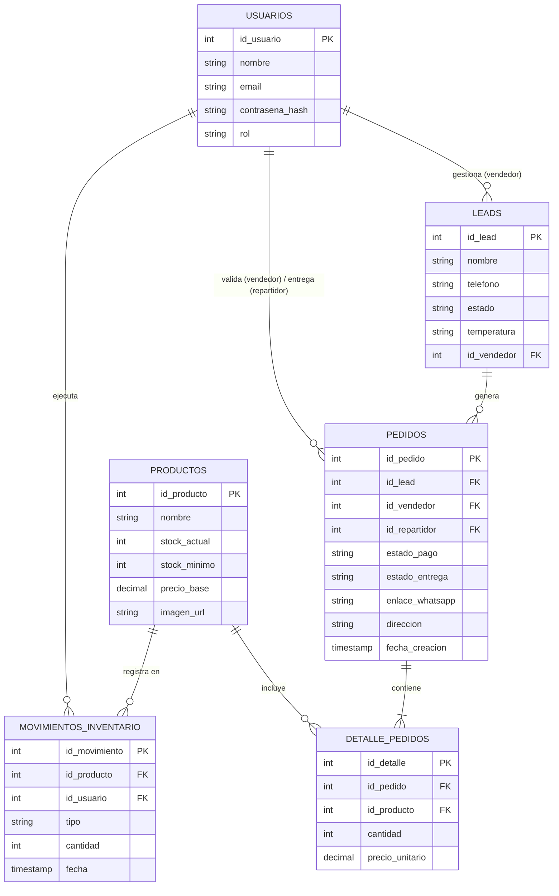

# Modelo Entidad-Relación (ER)

**Descripción:** Este documento define la estructura de la base de datos relacional de Etherware. Mapea la arquitectura de clases a tablas físicas, definiendo llaves primarias (PK), llaves foráneas (FK) y cardinalidad.

## 1. Reglas de Normalización

* **Seguridad:** Las contraseñas nunca se guardan en texto plano (se usa `contrasena_hash`). El control de acceso se maneja mediante la columna `rol` en la tabla `usuarios`.
* **Trazabilidad:** Se crea la tabla transaccional `movimientos_inventario` para auditar quién y cuándo modificó el stock, en lugar de solo sobrescribir el valor.
* **Integridad:** Se separa la `orden_entrega` de su `detalle_orden` para permitir múltiples productos por pedido (Relación Muchos a Muchos resuelta).

## 2. Diagrama ER (Mermaid)

