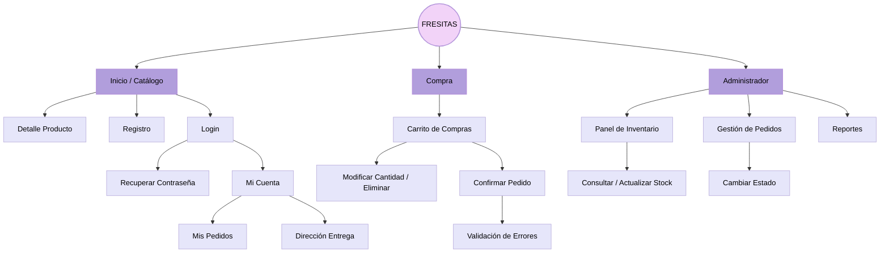

# Mapa de Navegación

**Descripción:** Este documento visualiza la arquitectura de páginas de la aplicación web Fresitas, definiendo la jerarquía del contenido y el recorrido del usuario (público, cliente autenticado y administrador).

## 1. Reglas de Navegación

* **Separación de roles:** El cliente navega por el catálogo, registro, carrito y confirmación; el administrador ingresa por login hacia inventario, pedidos y reportes.
* **Flujo de compra:** Diseñado para completar un pedido en pocos pasos (Inicio -> Catálogo -> Carrito -> Confirmación).
* **Prevención de errores:** Los flujos de registro y login incluyen validación de errores antes de continuar.

## 2. Diagrama de Navegación (Mermaid)

