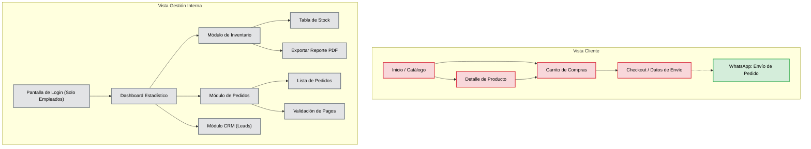

# Mapa de Navegación

**Descripción:** Este documento define la jerarquía de las pantallas y las rutas de navegación de Etherware, dividiendo estrictamente el acceso público (clientes) del acceso administrativo privado (empleados).

## 1. Reglas de Navegación

- **Separación de Portales:** El cliente final no se registra ni inicia sesión; navega libremente por el catálogo y el carrito hasta exportar su pedido.
- **Flujo de Compra (Público):** Diseñado para máxima fricción cero (Inicio -> Catálogo -> Carrito -> Checkout WhatsApp).
- **Acceso Protegido (Privado):** El Login es exclusivo para Vendedores y el Administrador. Una vez autenticados, aterrizan directamente en el Dashboard estadístico antes de ir a otros módulos operativos.

## 2. Diagrama de Navegación (Mermaid)

